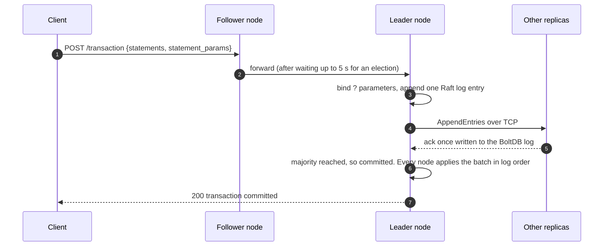
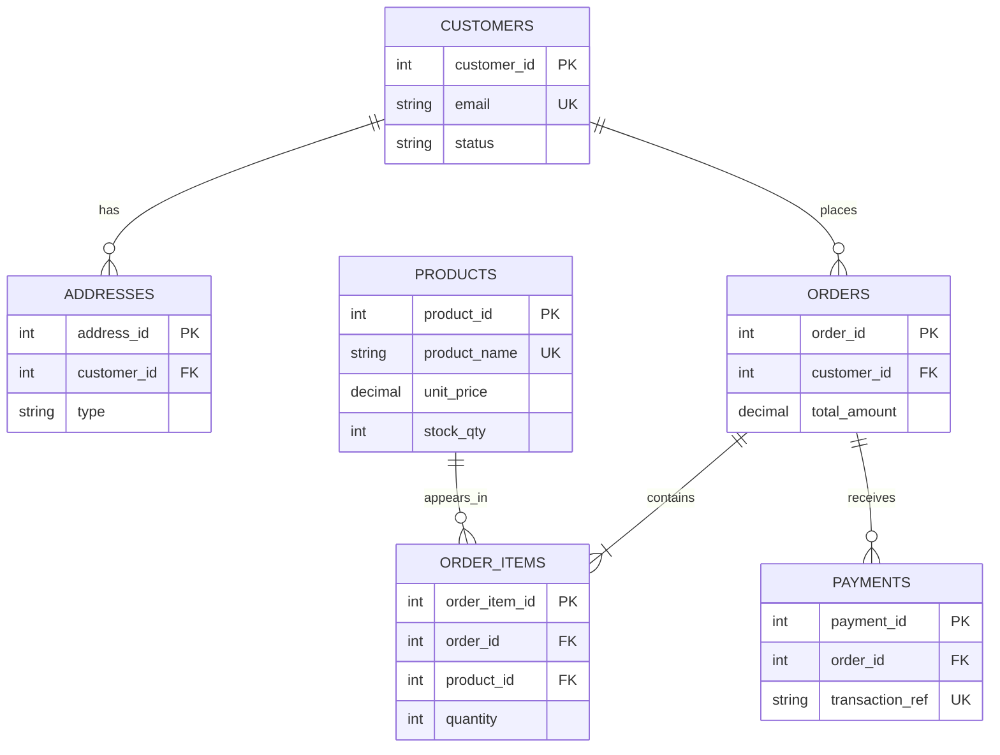
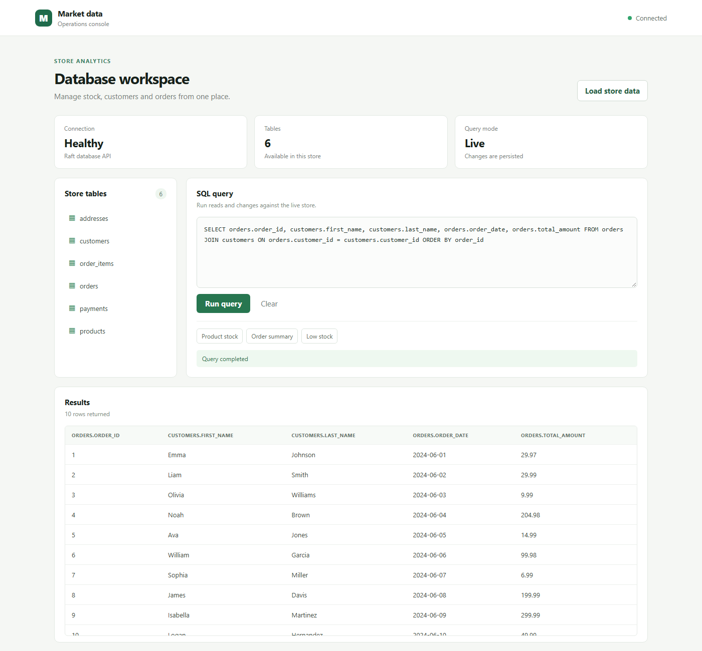
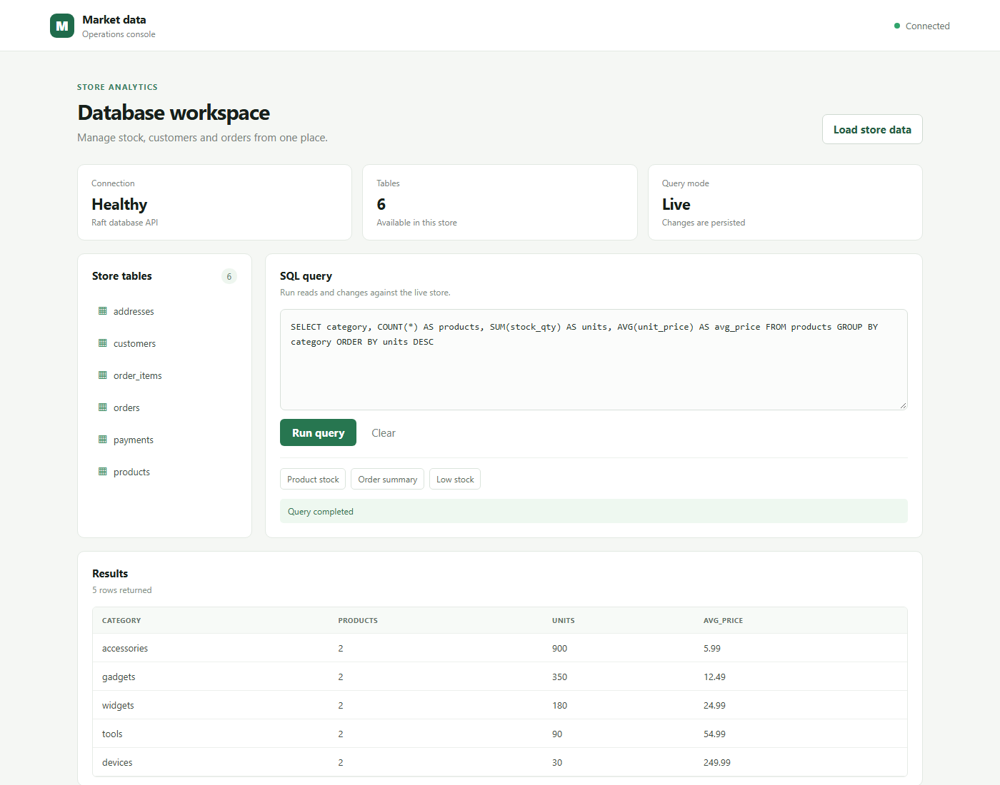

# Cloud-Native Distributed NewSQL Database with Raft Consensus and MVCC Transactions

**Course:** 23AIE303 – Database Management Systems
**Batch / Group:** BATCH_NO / GROUP_NO
**Repository:** https://github.com/sriram270506/Cloud-Native-Distributed-SQL-DB
**Project report (PDF):** [docs/report/Project_Report.pdf](docs/report/Project_Report.pdf)

## Team members

| # | Name | Roll number |
|---|------|-------------|
| 1 | Member 1 Name | Roll No. |
| 2 | Member 2 Name | Roll No. |
| 3 | Member 3 Name | Roll No. |

Team details also live in [docs/report/team.json](docs/report/team.json), which the report generator reads.

---

## 1. Overview, introduction and problem statement

A traditional relational database runs on a single server. If that server fails, the data is unavailable and recent writes can be lost. NewSQL systems such as Spanner, CockroachDB and TiDB keep SQL and ACID transactions, but replicate data across machines with a consensus protocol.

This project builds such a system from first principles and uses it to run a supermarket database:

- **Distributed engine (Go).** Each node is a separate process and a Raft voter. Writes are replicated over TCP and acknowledged only after a majority has saved them to a durable BoltDB log. Transactions use MVCC and are all-or-nothing on every replica. Reads are linearizable. If the leader fails, a new one is elected automatically.
- **Supermarket database (SQL).** Customers, addresses, products, orders, order lines and payments. The schema is normalized to BCNF, fully constrained and queried with advanced SQL.

**Problem statement.** A supermarket needs one consistent record of customers, products, orders and payments. That record must:
- stay available and correct when a server fails;
- apply multi-statement updates atomically;
- enforce integrity through keys and constraints;
- answer analytical questions in SQL;
- accept client input safely, with no SQL injection.

## 2. System requirements and architecture

### Requirements

| Tool | Version | Used for |
|------|---------|----------|
| Go | 1.26+ | Database engine and tests |
| Python | 3.10+ (stdlib only) | Reference schema tests, seeding, report generation |
| Node.js | 18+ | React frontend |
| Docker Desktop | optional | Three-container cluster |
| Kubernetes + kubectl | optional | StatefulSet deployment |
| Chrome or Edge | optional | Rebuilding the PDF report |

### Architecture



| Package | Responsibility |
|---------|----------------|
| [cmd/server](cmd/server/main.go) | HTTP API, forwarding to the leader, the transaction state machine, parameter binding, graceful shutdown |
| [raft](raft/node.go) | Hashicorp Raft over TCP, BoltDB log, snapshots, leader discovery, linearizable reads, leadership transfer |
| [sql](sql/engine.go) | SQL parser and executor, `?` parameter binding ([sql/params.go](sql/params.go)) |
| [mvcc](mvcc/engine.go) | Timestamped row versions, snapshot isolation, first-committer-wins conflicts |
| [storage](storage/) | Key-value store with a fsynced write-ahead log and atomic rewrite on rollback |
| [frontend](frontend/src/App.jsx) | React console: run SQL, load sample data |

Full details: [ARCHITECTURE.md](ARCHITECTURE.md). There is also a viva-style Q&A: [docs/distributed-sql-db-raft-mvcc-explainer.md](docs/distributed-sql-db-raft-mvcc-explainer.md).

## 3. ER diagram and UML diagram

ER diagram ([docs/supermarket_er.mmd](docs/supermarket_er.mmd)):



These diagrams show only key attributes. The full versions are in these files:
- [docs/supermarket_er.mmd](docs/supermarket_er.mmd): ER diagram with every attribute
- [docs/supermarket_uml.mmd](docs/supermarket_uml.mmd): UML class diagram
- [docs/system_class.mmd](docs/system_class.mmd): system component diagram
- [docs/write_path_sequence.mmd](docs/write_path_sequence.mmd): write-path sequence diagram

All four are rendered in the PDF report.

## 4. Relational schema mapping

Notation: **bold** = primary key, *italic* = foreign key.

| Relation | Attributes | Keys and constraints |
|----------|-----------|----------------------|
| customers | **customer_id**, first_name, last_name, email, created_at, updated_at, status | email UNIQUE; CHECK email format, status list, updated ≥ created |
| addresses | **address_id**, *customer_id*, line1, line2, city, state, postal_code, country, type | FK customers ON DELETE CASCADE; UNIQUE(customer_id, type); CHECK type list |
| products | **product_id**, product_name, category, unit_price, stock_qty, created_at, updated_at | product_name UNIQUE; CHECK price > 0, stock ≥ 0 |
| orders | **order_id**, *customer_id*, order_date, total_amount, status, created_at, updated_at | FK customers ON DELETE CASCADE; CHECK total ≥ 0, status list |
| order_items | **order_item_id**, *order_id*, *product_id*, quantity, unit_price, line_total, created_at | FK orders CASCADE, FK products RESTRICT; UNIQUE(order_id, product_id); CHECK qty > 0, line_total = qty × price |
| payments | **payment_id**, *order_id*, method, amount, paid_at, status, transaction_ref | FK orders CASCADE; transaction_ref UNIQUE; CHECK method and status lists, amount > 0 |

How the ER model maps to tables:
- Each entity becomes a table.
- Each 1:N relationship becomes a foreign key on the N side.
- The M:N relationship between orders and products becomes the associative table `order_items`.

## 5. Normalization and functional dependencies

| Relation | Functional dependencies | Candidate keys |
|----------|------------------------|----------------|
| customers | customer_id → all attributes; email → customer_id | {customer_id}, {email} |
| addresses | address_id → all attributes; (customer_id, type) → address_id | {address_id}, {customer_id, type} |
| products | product_id → all attributes; product_name → product_id | {product_id}, {product_name} |
| orders | order_id → all attributes | {order_id} |
| order_items | order_item_id → all attributes; (order_id, product_id) → order_item_id | {order_item_id}, {order_id, product_id} |
| payments | payment_id → all attributes; transaction_ref → payment_id | {payment_id}, {transaction_ref} |

The design starts from an unnormalized order sheet: `ORDER_SHEET(order_id, customer…, {product, qty, price}*, payment…)`. That sheet has a repeating group and update, insertion and deletion anomalies.

- **1NF:** The repeating product group becomes separate `order_items` rows, and every attribute is atomic.
- **2NF:** Every table has a single-attribute primary key. Product facts live in `products` and are not repeated per order line.
- **3NF and BCNF:** In every table, the determinant of every non-trivial dependency is a candidate key.

**Controlled redundancy.** Three stored values are kept on purpose:
- `order_items.unit_price` is the price at the time of sale. It is a separate fact from the current catalogue price.
- `line_total` is guarded by a CHECK constraint.
- `orders.total_amount` is checked by query Q9, which returns 0 rows.

## 6. Methodology and database design

1. **Requirements.** Identify the entities, their attributes and the business rules (for example: a product can appear at most once per order; a product that has been sold cannot be deleted).
2. **Conceptual design.** Draw the ER model and fix cardinality and participation.
3. **Logical design.** Map the ER model to relations, and choose keys and referential actions.
4. **Normalization.** List the functional dependencies and decompose the tables to BCNF.
5. **Physical design.** Write the DDL with constraints, indexes on foreign keys and filter columns, and the `order_summary` view.
6. **Implementation.** Write the reference SQL scripts in [database/](database/). Run the same data on the distributed Raft engine.
7. **Validation.** Run the automated constraint and query tests, the engine tests, the cluster smoke test and the failover test.

## 7. Database assets: the `database/` folder

| File | Contents |
|------|----------|
| [database/schema.sql](database/schema.sql) | Complete DDL: 6 tables with PRIMARY KEY, FOREIGN KEY (ON DELETE CASCADE or RESTRICT), UNIQUE, NOT NULL, DEFAULT and named CHECK constraints; 6 indexes; 1 view |
| [database/seed.sql](database/seed.sql) | Sample records (10–12 rows per table), loaded in one transaction |
| [database/queries.sql](database/queries.sql) | 14 documented advanced queries |
| [database/run_queries.py](database/run_queries.py) | Builds the database in SQLite and records every query's output |
| [database/test_database.py](database/test_database.py) | 16 test cases covering constraints, cascades and query results |
| [database/seed_cluster.py](database/seed_cluster.py) | Creates and populates the tables on the live Raft cluster using parameterized transactions |
| [database/results/](database/results/) | Generated outputs: `query_results.md`, `cluster_demo.md`, `failover_demo.md` |

The same rows are also stored as CSV files in [data/sample_db/](data/sample_db/).

## 8. Advanced SQL queries and their purpose

| # | Technique | Purpose |
|---|-----------|---------|
| Q1 | 4-table join | Invoice view: customer, order, product and line |
| Q2 | GROUP BY + COUNT DISTINCT / SUM / AVG | Revenue, units and orders per category |
| Q3 | GROUP BY … HAVING | Categories with revenue over 100 |
| Q4 | Correlated subquery | Customers who spent more than the average order value |
| Q5 | NOT EXISTS | Products never ordered (dead stock) |
| Q6 | Nested IN subqueries | Customers who paid with PayPal |
| Q7 | LEFT JOIN + COALESCE | Order count and spend for every customer, including those with none |
| Q8 | CTE + window function (RANK) | Product revenue rank within each category |
| Q9 | Aggregate integrity check | Stored order totals match the sum of their lines (expect 0 rows) |
| Q10 | CASE | Gold, silver and bronze customer tiers |
| Q11 | Scalar subquery | Each product's price compared with its category average |
| Q12 | View | Fully paid orders, read from `order_summary` |
| Q13 | UNION | Home and work cities in one list |
| Q14 | BETWEEN on dates | Daily revenue for one week |

The SQL text and output of every query are in [database/results/query_results.md](database/results/query_results.md).

**Supported SQL on the distributed engine:**
- `CREATE TABLE`, `INSERT`, `UPDATE`, `DELETE` and `DROP TABLE`
- `SELECT` with `WHERE` (AND, OR, LIKE and comparisons), a two-table inner `JOIN`, `GROUP BY`, `HAVING`, `COUNT/SUM/AVG/MIN/MAX`, `ORDER BY`, `LIMIT` and `OFFSET`
- multi-statement transactions

Constraint enforcement and subqueries are done by the reference schema (SQLite or PostgreSQL). For the distributed engine they are listed under future scope.

### Parameterized queries (SQL injection prevention)

Clients send values separately from SQL, as bound parameters:

```json
POST /query        {"sql": "SELECT * FROM customers WHERE email = ?", "params": ["ava.jones@example.com"]}
POST /transaction  {"statements": ["INSERT INTO products (product_id, product_name) VALUES (?, ?)"],
                    "statement_params": [[11, "O'Brien's Tea"]]}
```

How a request is processed:
1. The leader binds each value as an escaped literal.
2. The engine hex-encodes every literal before parsing, so a value can never be read as SQL.
3. The bound statements go into the Raft log.

[sql/params_test.go](sql/params_test.go) runs injection payloads such as `x' OR '1'='1` and checks that they match 0 rows. The frontend and `seed_cluster.py` send every value as a parameter.

## 9. Installation, setup and execution

```powershell
git clone https://github.com/sriram270506/Cloud-Native-Distributed-SQL-DB.git
cd Cloud-Native-Distributed-SQL-DB
go mod download
cd frontend; npm ci; cd ..
```

### Create and populate the reference database (SQLite)

```powershell
python database/run_queries.py --db database/supermarket.db   # runs schema.sql, seed.sql, queries.sql
```

To run the same scripts on PostgreSQL instead, delete the `PRAGMA` line in `schema.sql` first:

```
psql -d shop -f database/schema.sql -f database/seed.sql -f database/queries.sql
```

### Run the distributed database

Start a three-node cluster on this machine. HTTP is on ports 8080 to 8082 and Raft on ports 7000 to 7002.

```powershell
.\scripts\cluster.ps1          # Linux/macOS: ./scripts/cluster.sh
python database/seed_cluster.py
```

Alternatives:
- **Docker:** `docker compose up -d --build` runs one container per node, with HTTP on ports 8080 to 8082.
- **Kubernetes:** run `docker build -t cndsdb:latest .`, then `kubectl apply -f deploy/k8s/cndsdb.yaml`, then `kubectl port-forward svc/cndsdb 8080:8080`.
- **Single node:** `go run ./cmd/server`

To stop the local cluster, run `Get-Process cndsdb | Stop-Process` on Windows or `kill $(cat data/runtime/*.pid)` on Linux/macOS.

#### Server flags

| Flag | Meaning |
|------|---------|
| `-id` | Unique Raft server ID |
| `-port` | HTTP port |
| `-raft-addr` | Raft TCP bind address |
| `-advertise` | Raft address peers dial to reach this node. Defaults to `-raft-addr` |
| `-peers` | Every voter as `id=raft_host:port=http_host:port`, comma-separated |
| `-data` | Data directory. Each node uses `<data>/<id>` |
| `-probe URL` | Run a health check against URL and exit (used in containers) |

#### HTTP API

| Endpoint | Meaning |
|----------|---------|
| `POST /query` | One statement: `{"sql": "...", "params": [...]}` |
| `POST /transaction` | Atomic batch: `{"statements": [...], "statement_params": [[...], ...]}` |
| `GET /tables` | List tables |
| `GET /health` | Raft state, term, commit and applied index, the leader and the members |
| `GET /ready` | 200 once a leader is known |

### Run the frontend

```powershell
cd frontend
npm run dev        # open http://localhost:5173
```

Click **Load store data** if the cluster is empty. Then run SQL from the editor. A link like `http://localhost:5173/?sql=SELECT%20*%20FROM%20products` opens the console and runs that query.

## 10. Demonstration: reproducing the results

1. **Tests.** Run `go test ./...` and `python -m unittest discover -s database -v`. All tests should pass.
2. **Reference database.** Run `python database/run_queries.py`. It regenerates [database/results/query_results.md](database/results/query_results.md).
3. **Cluster.** Start the cluster as shown above, then run `.\scripts\smoke.ps1`. The smoke script waits for a leader, runs DDL, DML and a transaction, and reads the result back.
4. **Seed and demo.** Run `python database/seed_cluster.py`. It regenerates [database/results/cluster_demo.md](database/results/cluster_demo.md).
5. **Failover.**
   1. Read `GET http://localhost:8080/health` and note `leader_id`.
   2. Kill that node's process, or run `docker compose stop nodeN`.
   3. Immediately send a write to another node. It commits after the new election, in about 2 s.
   4. Restart the node. Its `applied_index` catches up.

   A recorded run is in [database/results/failover_demo.md](database/results/failover_demo.md).
6. **Report.** After editing `docs/report/team.json`, run `python docs/report/build_report.py`. It regenerates [docs/report/Project_Report.pdf](docs/report/Project_Report.pdf).

To reset the database state, stop the cluster and delete `data/runtime/`, or run `docker compose down -v`. Then repeat steps 3 and 4.

## 11. Test cases and validation

| Suite | Command | Covers |
|-------|---------|--------|
| Engine (Go) | `go test ./...` | MVCC isolation and conflicts; SQL CRUD, filters, joins and grouping; parameter binding against injection; WAL rollback durability; 3-node Raft over TCP with replication, failover and recovery from the log |
| Schema (Python) | `python -m unittest discover -s database -v` | Seed counts; no dangling FKs; PK, UNIQUE, FK and RESTRICT violations rejected; 8 CHECK rules; cascading deletes; every documented query runs with the expected results |
| Smoke | `scripts/smoke.ps1`, `scripts/smoke.sh` | End-to-end HTTP API on a live cluster |
| Failover | Section 10, step 5 | Leader loss, re-election, catch-up |

## 12. Screenshots and sample outputs

| Join on the live cluster | GROUP BY on the live cluster |
|---|---|
|  |  |

Sample outputs are in [database/results/](database/results/).

## 13. Conclusion and future scope

The supermarket database is normalized to BCNF, fully constrained and covered by tests. It runs on a database engine built for this project, which:
- replicates every write through Raft;
- keeps transactions all-or-nothing on every replica;
- serves linearizable reads;
- survives the loss of its leader without losing acknowledged writes.

**Future scope:**
- Enforce FOREIGN KEY, UNIQUE and CHECK constraints in the distributed engine.
- Support subqueries and joins of more than two tables in the distributed engine.
- Shard data into multiple Raft groups.
- Allow nodes to join and leave a running cluster.
- Add TLS and authentication.
- Move to an on-disk LSM storage engine with typed columns and secondary indexes.

## License

[MIT](LICENSE)
